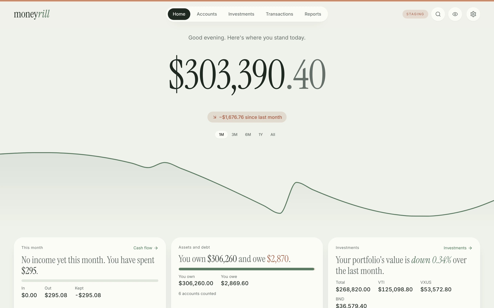
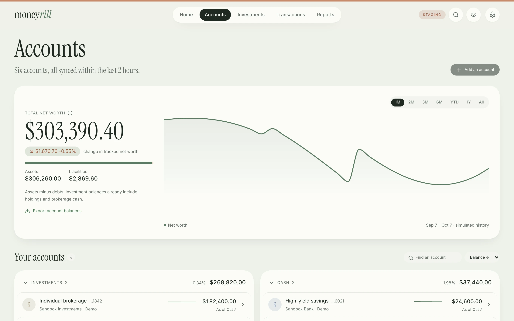
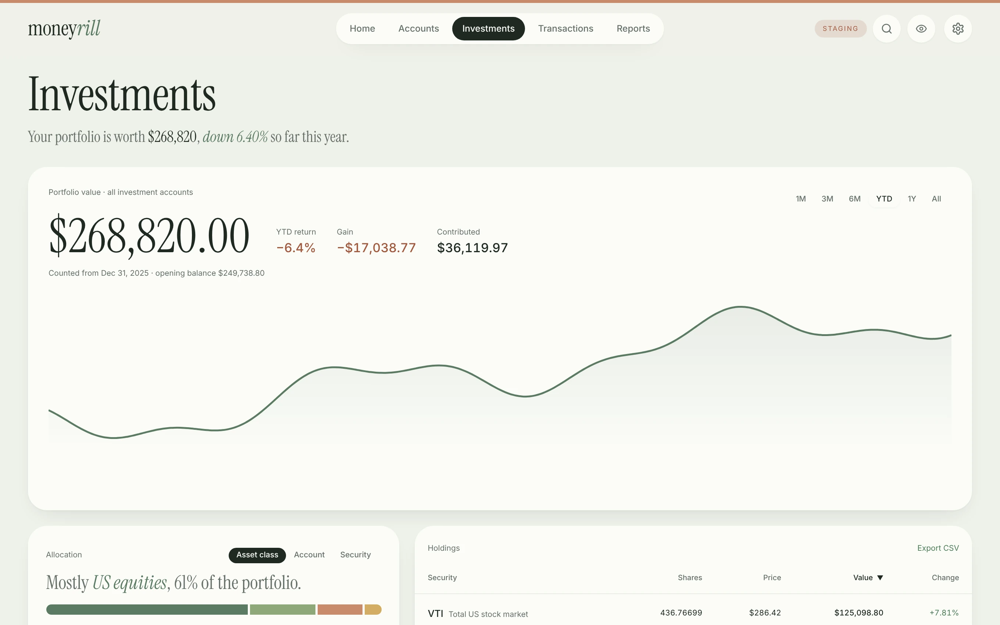
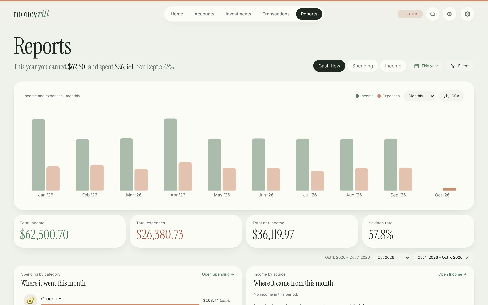
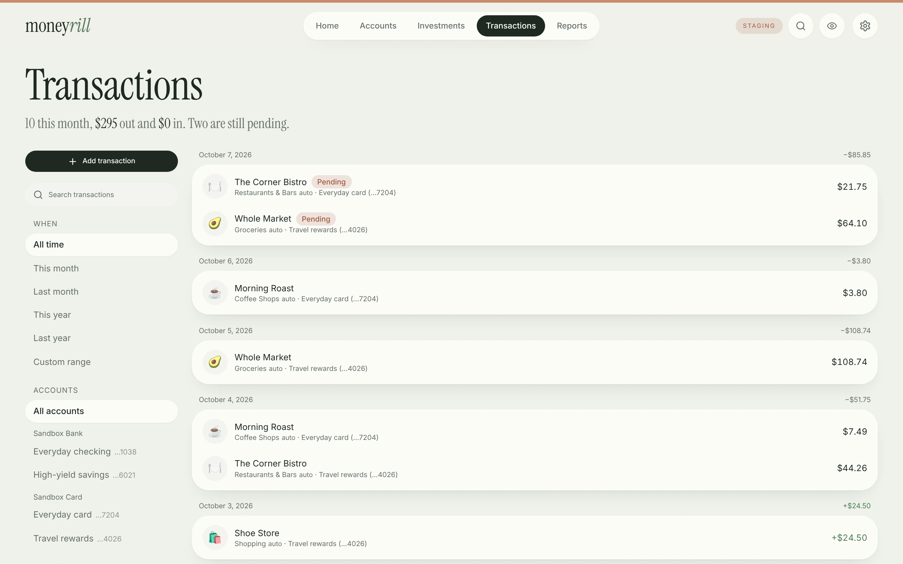
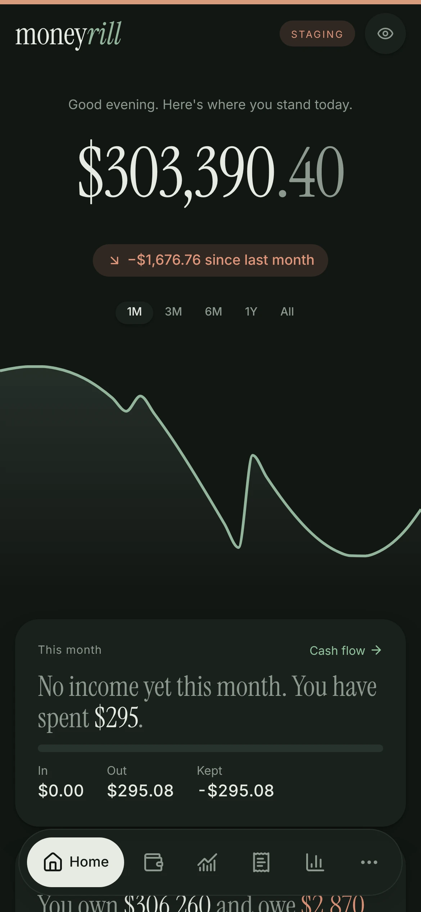
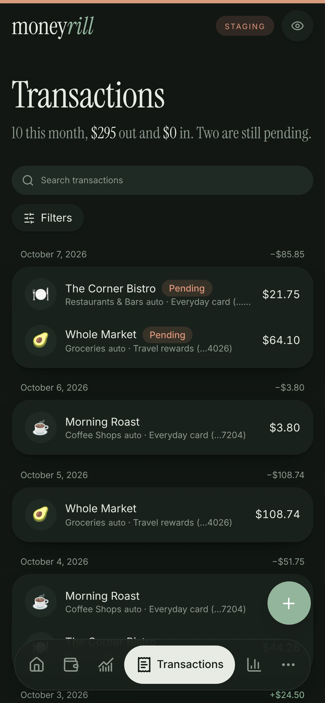
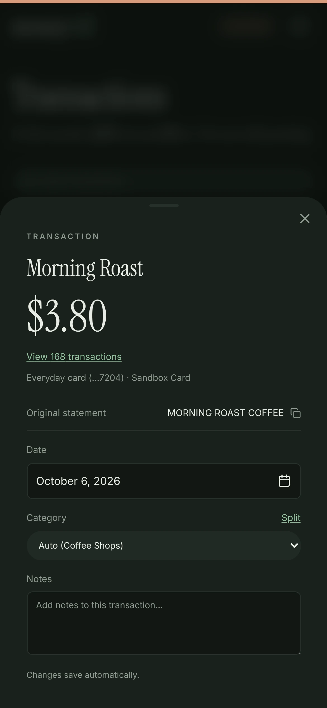
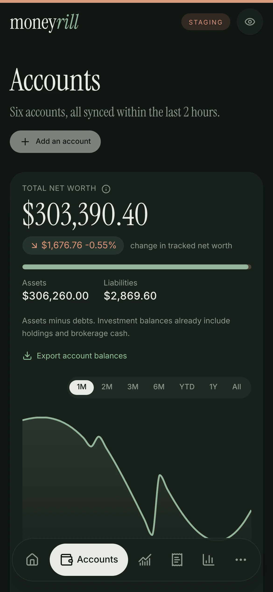

<p align="center">
  <picture>
    <source media="(prefers-color-scheme: dark)" srcset="docs/logo-dark.png" />
    
  </picture>
</p>

# Moneyrill

Your accounts, net worth, investments and spending in one private app that runs on your own computer. Connect banks and brokerages through your own Plaid account, or enter everything by hand. No cloud service, no subscription, no telemetry.

<p align="center"></p>

<table>
  <tr>
    <td width="50%"></td>
    <td width="50%"></td>
  </tr>
  <tr>
    <td width="50%"></td>
    <td width="50%"></td>
  </tr>
</table>

<table>
  <tr>
    <td width="25%"></td>
    <td width="25%"></td>
    <td width="25%"></td>
    <td width="25%"></td>
  </tr>
</table>

_Screenshots of the staging app with its made-up demo data (the STAGING badge and strip mark staging; production shows neither). They are taken by [`scripts/screenshots.mjs`](scripts/screenshots.mjs), and the Zen design mockups they follow are in [`docs/design/zen/`](docs/design/zen/), which also has the dark desktop versions and the Settings page._

## Features

- **Net worth** over time across cash, cards, loans and investments, with a page and history for each account.
- **Investments**: holdings, allocation, per-security detail, and a return that leaves out deposits and withdrawals, compared with the S&P 500 and Nasdaq-100.
- **Transactions** you can edit (date, category, notes), split, or add yourself (an RSU vest, a 401(k) contribution). A sync never overwrites your edits.
- **Reports**: cash flow, spending and income by category and merchant.
- **Import and export**: a Monarch CSV import, a JSON archive, CSV downloads.
- **Private mode** hides every amount; the calm Zen look in light and dark; a phone layout.
- **Local first**: PostgreSQL on your machine, bank tokens encrypted at rest, encrypted verified backups.

## Quick start

Needs Docker (macOS or Linux).

```sh
git clone <this repository> moneyrill && cd moneyrill
./scripts/setup.sh staging       # creates .env and a random key; nothing leaves your computer
./scripts/deploy.sh staging      # builds the image, starts the app, worker and PostgreSQL
open http://localhost:3002       # Linux: xdg-open
```

You get simulated accounts, holdings, transactions and reports to explore. `docker compose down` stops it; add `-v` to delete the demo data.

## Connect real accounts

- Moneyrill runs no service for you, so you need your own [Plaid](https://plaid.com) keys. Sandbox keys (fake banks) are free; real banks need Plaid Production access, and its free trial allows only a limited number of connections.
- Try Sandbox: put `PLAID_CLIENT_ID` and `PLAID_SECRET` in `.env`, redeploy, then **Settings → Add an account**.
- Real banks use a separate production setup with its own database and key: see [Running Moneyrill](docs/development/OPERATIONS.md).
- No Plaid? Add accounts and balances by hand, record transactions, or import a [Monarch](https://www.monarchmoney.com) CSV.

## Configuration

Set these in `.env` (demo and Sandbox) or `.env.production`.

| Variable                          | Default               | Meaning                                                                                                                          |
| --------------------------------- | --------------------- | -------------------------------------------------------------------------------------------------------------------------------- |
| `PLAID_CLIENT_ID`, `PLAID_SECRET` | empty                 | Your Plaid keys (Sandbox in `.env`, Production in `.env.production`; never mix them)                                             |
| `SYNC_CRON`                       | `0 13 * * *`          | Default sync time; **Settings → Sync settings & activity** overrides it                                                          |
| `SYNC_TIMEZONE`                   | `America/Los_Angeles` | Default time zone for `SYNC_CRON` (an IANA name, e.g. `Europe/Berlin`)                                                           |
| `MARKET_DATA`                     | on                    | `off` never contacts Yahoo Finance: no benchmark lines or ticker price history                                                   |
| `ALLOW_LAN`, `BIND_ADDRESS`       | off                   | Also serve one private Wi-Fi address; sign-in is always required ([details](docs/development/OPERATIONS.md))                     |
| `STAGING_PORT`, `PRODUCTION_PORT` | `3002`, `3003`        | The port each environment is published on (`http://localhost:<port>`); set either in `.env`, or in `.env.production` to override |
| `TRUST_PROXY`                     | off                   | `true` only behind a reverse proxy you run on this computer: use its `X-Forwarded-*` headers                                     |

## Security

Moneyrill is for one person on a trusted network: one passphrase, no user accounts, no HTTPS or remote access yet. **Do not expose it to the internet.** It listens on `localhost` (optionally one private Wi-Fi address), checks host and origin on every request, sends a Content-Security-Policy, encrypts tokens at rest and runs as an unprivileged container user. See [SECURITY.md](SECURITY.md) to report a problem privately.

## Data sources and limits

- **Plaid** supplies balances, holdings and bank and card transactions (about 90 days for existing connections, up to two years for new ones). Brokerage transactions are not included yet.
- **Yahoo Finance's unofficial chart endpoint** supplies benchmark and ticker prices. It has no published terms and can change or block requests at any time; a failed download keeps what you have. `MARKET_DATA=off` disables it.
- Not financial, tax or investment advice. Not affiliated with Plaid, Monarch or Yahoo.

## Documentation

- [Specifications](docs/specs/README.md): what each feature does, how the numbers are calculated and the rules it keeps, in build order; enough to rebuild the app
- [Running Moneyrill](docs/development/OPERATIONS.md): environments, sign-in, Wi-Fi access, backups, releases
- [Developing Moneyrill](docs/development/DEVELOPMENT.md) and [CONTRIBUTING.md](CONTRIBUTING.md): code layout, checks, how to contribute
- [TODO.md](TODO.md), [CHANGELOG.md](CHANGELOG.md)

## License

[MIT](LICENSE). The software is provided as is; you are responsible for the security of your installation and the financial data in it.
