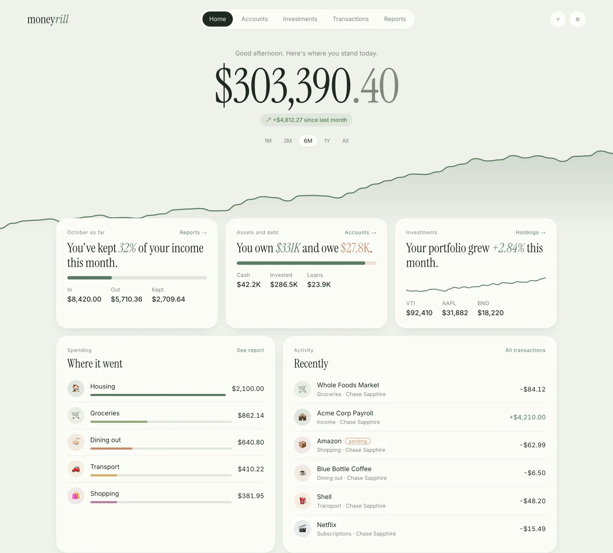

# Zen theme

Status: all seven phases are done (phase 7: the README shows the design mockups; real screenshots are optional, see TODO.md); phase 1 (tokens, fonts, primitives) is merged (#57); phase 2 (navigation) is merged (#58); phase 3 (headings and sentences) is merged (#59); phase 4 (Home) is merged (#60); phase 5 (Transactions) is merged (#61); phase 6 is split by page: Accounts is merged (#62), Investments is merged (#63), Reports is merged (#64), and Settings with Login (the last of phase 6) is merged (#65). A follow-up matches the mockups more closely (Home, Investments, Transactions filters, Reports) and is in review. Written 2026-10-06 for
a later session to carry out phase by phase.

Moneyrill's look moves to **Zen**: a calm sage-and-cream palette, a tall serif for headings and big numbers, soft
rounded cards without borders, and pages that open with one plain sentence about your money ("You've kept 32% of
your income this month."). Light and dark ("Zen night") both ship.

The reference mockups are in [`docs/design/zen/`](../design/zen/). They use fake data and are the target for every
phase below. Read [Before you start](#before-you-start) first.

## Mockups

| Page           | Light                                                                                     | Dark                                                                |
| -------------- | ----------------------------------------------------------------------------------------- | ------------------------------------------------------------------- |
| Home           | [desk-home](../design/zen/desk-home.webp)                                                 | [desk-home-dark](../design/zen/desk-home-dark.webp)                 |
| Transactions   | [desk-transactions](../design/zen/desk-transactions.webp)                                 | [desk-transactions-dark](../design/zen/desk-transactions-dark.webp) |
| Accounts       | [desk-accounts](../design/zen/desk-accounts.webp)                                         | [desk-accounts-dark](../design/zen/desk-accounts-dark.webp)         |
| Investments    | [desk-investments](../design/zen/desk-investments.webp)                                   | [desk-investments-dark](../design/zen/desk-investments-dark.webp)   |
| Reports        | [desk-reports](../design/zen/desk-reports.webp)                                           | [desk-reports-dark](../design/zen/desk-reports-dark.webp)           |
| Settings       | [desk-settings](../design/zen/desk-settings.webp)                                         | [desk-settings-dark](../design/zen/desk-settings-dark.webp)         |
| Phone, board 1 | [mobile-1](../design/zen/mobile-1.webp): Home, Transactions, Transaction detail, Accounts | [mobile-1-dark](../design/zen/mobile-1-dark.webp)                   |
| Phone, board 2 | [mobile-2](../design/zen/mobile-2.webp): Investments, Reports, Category report, Settings  | [mobile-2-dark](../design/zen/mobile-2-dark.webp)                   |

The HTML that produced them is in [`docs/design/zen/source/`](../design/zen/source/README.md). Its CSS is the
easiest place to read exact sizes and spacing. It is a picture, not app code: do not copy its markup into `src/`.

## Before you start

- Follow `CLAUDE.md` and `CONTRIBUTING.md`: a worktree per phase, one pull request per phase, `npm run check` green,
  `./scripts/ship.sh --stage-only`, check the result on staging (http://localhost:3002) yourself, open the pull
  request with `./scripts/pr.sh`, then **stop and ask the owner to approve the merge**. Never merge or promote
  without being asked.
- **A restyle must not change behaviour.** Every click, link, filter, sort, private-mode mask, Customize Home
  option, tab-bar setting and keyboard path works as before. When a phase does change behaviour (the navigation
  phase does), write "before -> after" in the pull request.
- Use staging only. Never look at production data to check a design.
- No requests to outside servers at run time. The Content-Security-Policy (`server/app.ts`) allows fonts from
  `'self'` only, and the app must work offline, so fonts are bundled (phase 1), never loaded from Google Fonts.
- The mockups show some things the app does not have yet. They are listed under
  [Not part of this plan](#not-part-of-this-plan); do not build them as part of a restyle.

## How styling works today

- `src/app.css` loads Tailwind 4 and maps shadcn-style names (`bg-card`, `text-muted-foreground`, `bg-accent`,
  `text-positive`, ...) to the app's variables. Components use those names, so changing the variables restyles
  most of the app at once.
- `src/theme.css` holds the variables. Dark is `:root`; light is `:root[data-theme='light']`. Most are named after
  their old dark hex value (`--c-111817` is the page background), which no longer describes them once Zen lands.
- The theme choice (Match device, Light, Dark) lives in `src/state/theme.ts`, Settings -> Display and navigation,
  and the Topbar button. `index.html` has an inline script that sets `data-theme` before first paint; its CSP hash
  is computed from the built page, so editing it needs no policy change.
- `--font-serif` is Georgia today; the body asks for Inter but no Inter font file is bundled.
- Hard-coded colours that bypass the variables (all need to move to variables):
  - `src/lib/format.ts` `COLORS` (8, used by holdings, allocation, Home categories, accounts)
  - `src/lib/reports.ts` `SLICE_COLORS` (12) and the `'rest'` slice `#6f7f77`
  - `src/components/PortfolioCard.tsx` `BENCHMARK_COLORS` and the area gradient/stroke (`#58c9af`, `#65d7b9`)
  - `src/components/common.tsx`, `SpendingTrend.tsx`, `SecurityDrawer.tsx`: the same gradient/stroke
  - `src/components/reports/CashFlowReport.tsx` `GREEN`/`RED`, `reports/History.tsx` income/expense colour
  - `src/components/AccountsTab.tsx` sparkline stroke
  - `src/state/theme.ts` and `index.html`: the browser `theme-color` values

## Design tokens

Values for `src/theme.css`. "Text" colours were checked against WCAG AA (4.5:1 for body text). The mockups use a
lighter grey and clay for small text, which fail AA in light mode; use the adjusted values below in the app.

| Role (current variable)                           | Light                                                                | Dark                                                         | Notes                                         |
| ------------------------------------------------- | -------------------------------------------------------------------- | ------------------------------------------------------------ | --------------------------------------------- |
| Page background (`--c-111817`)                    | `#eef1ea`                                                            | `#121714`                                                    | also `theme-color`                            |
| Card / surface (`--c-19221e`, `--surface`)        | `#fbfcf8`                                                            | `#1a211c`                                                    |                                               |
| Muted surface, inputs, chips (`--c-1b261f`)       | `#f3f5ef`                                                            | `#212a24`                                                    |                                               |
| Hover / selected (`--c-2b4534`, accent)           | `#dfe7da`                                                            | `#26332b`                                                    | the "soft" green                              |
| Hairline (`--c-2b3932`, `--line`)                 | `#e7ebe3`                                                            | `#26302a`                                                    | cards have no border; lines only inside lists |
| Text (`--c-e7eee8`)                               | `#1f2a22`                                                            | `#e6ebe3`                                                    | 13.0:1 / 15.0:1                               |
| Muted text (`--c-8d9e94`, `--muted`)              | `#66706a`                                                            | `#8d998f`                                                    | mockup `#7d877f` is 3.3:1 on light, too low   |
| Primary button (`--c-b5dba4`)                     | `#1f2a22`                                                            | `#e6ebe3`                                                    | buttons are ink-on-cream pills                |
| Primary button text (`--c-1f3524`)                | `#fbfcf8`                                                            | `#121714`                                                    |                                               |
| Positive / up (`--c-69d4b2`, `--green`)           | `#4d7c57`                                                            | `#93c49f`                                                    | 4.7:1 / 8.3:1                                 |
| Accent sage, links, focus (`--c-96c590`)          | `#5b7a62`                                                            | `#93b59b`                                                    |                                               |
| Negative / attention text (`--c-e79998`, `--red`) | `#a35a3f`                                                            | `#e0957a`                                                    | mockup `#b0644a` is 4.3:1, slightly low       |
| Clay fill (new `--clay`)                          | `#c98b6b`                                                            | `#d79c7d`                                                    | bars, debt share, Reconnect button background |
| Shadow (new `--shadow`)                           | `0 1px 2px rgba(30,40,30,.04), 0 12px 32px -18px rgba(30,40,30,.18)` | `0 1px 2px rgba(0,0,0,.3), 0 14px 34px -18px rgba(0,0,0,.6)` | replaces card borders                         |

Charts (new variables, both themes; replace the hard-coded colours listed above):

| Variable                                  | Light                              | Dark                               |
| ----------------------------------------- | ---------------------------------- | ---------------------------------- |
| `--chart-line`                            | `#5b7a62`                          | `#93b59b`                          |
| `--chart-fill` (gradient top)             | `#5b7a62` at 20% opacity           | `#93b59b` at 25% opacity           |
| `--income`                                | `#5b7a62`                          | `#93b59b`                          |
| `--expense`                               | `#c98b6b`                          | `#d79c7d`                          |
| `--chart-grid`, `--chart-tick`, `--tip-*` | `#e7ebe3`, `#66706a`, card colours | `#26302a`, `#8d998f`, card colours |

Category and slice palette, in this order (`--cat-1` ... `--cat-12`). The first eight replace `COLORS`, all twelve
replace `SLICE_COLORS`. Dark mode uses the same hues lifted about 10% in lightness:

`#5b7a62` sage, `#8fa878` olive, `#c98b6b` clay, `#d2ad62` ochre, `#b4809a` mauve, `#7d90ad` slate, `#6fa3a0` teal,
`#a7987a` sand, `#8c7aa8` heather, `#b9785a` rust, `#7fa6c0` mist, `#a3a65f` moss. The "everything else" slice is
`--muted`.

Recharts accepts `var(--name)` in `stroke`, `fill` and `stopColor` (shadcn's chart components rely on this), so
the constants become strings like `'var(--cat-1)'`. Check every place that might do colour arithmetic on them
(none found on 2026-10-06; search for the constants before changing them).

Shape and type:

- Radius: cards 26px (22px on phones), pills and buttons fully round (`rounded-full`), inputs 999px or 14px.
- Cards: `bg-card`, no border, `--shadow`. Lists inside a card keep 1px hairlines between rows.
- Fonts: **Instrument Serif** (headings, big numbers, the summary sentences, italics for highlighted figures) and
  **Inter** (everything else). Both are SIL Open Font License. Bundle them with `@fontsource/instrument-serif` and
  `@fontsource-variable/inter` (two new dependencies; the pull request needs the sentence "bundled so the CSP and
  offline use need no external font requests"). Set `--font-serif: 'Instrument Serif', Georgia, serif` and the
  root font to `'Inter Variable', Inter, -apple-system, ...`.
- Sizes (laptop / phone): page title 64 / 44px serif; page sentence 24 / 19px serif in `--muted` with key figures in
  `--foreground`; hero net worth 112 / 64px serif with the cents in `--muted`; card numbers 40-64px serif; card
  eyebrow 12px Inter muted with 0.04em tracking; body 14-15px Inter; amounts always `tabular-nums`.
- Highlighted figures inside a sentence are serif italic in sage (`<em>`), debts in clay.

## Phases

Each phase is one pull request. Phases 1 and 2 give most of the visible change with the least risk; the owner can
pause after any phase.

### Phase 1: tokens, fonts and primitives

Goal: the whole app wears Zen colours, fonts and card shapes. No layout, copy or behaviour changes.

1. `src/theme.css`: set every value in [Design tokens](#design-tokens) for light and dark; add `--clay`,
   `--shadow`, `--chart-line`, `--chart-fill`, `--income`, `--expense`, `--cat-1..12`. Keep the existing variable
   names in this phase so no component changes are needed for colour alone.
2. `src/app.css`: `--font-serif` and the root font; map any new names you need in `@theme inline` (for example
   `--color-clay`, `--shadow-card`).
3. Fonts: add the two `@fontsource` packages, import them once (in `src/main.tsx` or `app.css`), confirm in the
   built `dist/` that the `.woff2` files are served from the app itself and the browser console shows no CSP errors.
4. Primitives in `src/components/ui/`: `card.tsx` (no border, `--shadow`, 26px radius), `button.tsx` (pill shapes;
   `default` ink on cream, `outline` becomes a soft filled pill), `badge.tsx`, `segmented.tsx` (pill track with the
   selected item ink or card), `input.tsx`, `select.tsx`, `switch.tsx` (sage when on), `dialog.tsx` (serif heading,
   26px radius), `popover.tsx`, `table.tsx` (hairlines only).
5. Replace every hard-coded colour listed in [How styling works today](#how-styling-works-today) with variables.
6. `src/state/theme.ts` `COLORS` and the `index.html` inline script: `theme-color` `#eef1ea` / `#121714`.
7. Test: add `tests/theme.test.ts` that fails if a hex colour appears in `src/**/*.{ts,tsx}` outside `src/theme.css`
   (allow-list nothing; this keeps light and dark in step from now on).
8. Check on staging: every page in light and dark at 1440px and 390px, Private mode on and off, a dialog, a
   popover, the transaction drawer, the login page (staging with a throwaway passphrase only, cleared afterwards).
   Compare against the mockups for colour and type, not layout.

### Phase 2: navigation

Goal: the laptop top bar and the phone floating tab bar from the mockups. This phase changes layout, so the pull
request lists before -> after.

- Laptop (above 760px), before -> after: left sidebar with every page -> top bar with the `money`_`rill`_ wordmark at
  the left, a centred pill of Home, Accounts, Investments, Transactions, Reports, and round search and Settings
  buttons at the right (Settings highlighted when open). Keep "Yours to keep." and the workspace block somewhere
  sensible (Settings page side column, as in the Settings mockup). The Topbar's environment badge, Offline-ready
  note, Private mode and theme buttons move into the right side of the top bar.
- Phone (760px and below), before -> after: full-width bar -> a floating pill 18px from the sides and 30px from the
  bottom (respect `env(safe-area-inset-bottom)`), icons only, the selected tab expands to ink with its label.
  **Keep the tab-bar customisation** (`src/lib/navigation.ts`, Settings -> Display and navigation): the chosen pages
  in the chosen order, Home always first, More when pages are left over. Page content needs enough bottom padding
  that the last row is never hidden behind the floating bar.
- Decide (owner): whether search opens the transaction search (it exists on Transactions today) or is dropped from
  the top bar. Default if not answered: link to Transactions with the search box focused.
- Tests: `tests/ui/phone-layout.test.tsx` and `settings-nav.test.tsx` assert nav classes and the More menu. Update
  them on purpose to the new structure; keep the behaviours they check (bar order, More, Settings off the bar).

### Phase 3: page headings and summary sentences

Goal: every page opens with its name as a large serif title and one plain sentence built from the data, as in the
mockups. Replaces `PageHeading.tsx`'s fixed taglines ("Good to see you.", "Everything, in one place.", ...).

- New pure module `src/lib/summary.ts` with one function per page, each taking the numbers it needs and returning
  parts (text plus highlighted figures) rather than a string, so the component can style figures. Unit tests in
  `tests/summary.test.ts` for each sentence, including empty states (no accounts, no income this month, no
  investments, first day of the month).
- Sentences (match the mockups; keep them short and factual, no advice):
  - Home: no sentence; the hero shows "Good afternoon. Here's where you stand today." over net worth.
  - Accounts: "{n} accounts, all synced within the last {age}." plus "{k} need(s) reconnecting." when any has
    `last_error`.
  - Investments: "Your portfolio is worth {value}, up/down {pct} this month."
  - Transactions: "{count} this month, {out} out and {in} in." plus "{p} are still pending." when any are pending.
  - Reports: "This year you earned {income} and spent {spending}. You kept {rate}." (follows the chosen date range,
    not always "this year").
  - Settings: "Everything stays on this machine, in your own database." plus "{k} connection(s) need your
    attention." when any do.
- **Invariant: Private mode hides every amount in a sentence.** Format money only through `cash()` and friends in
  `src/lib/format.ts`, which already respect Private mode; add a UI test that turns Private mode on and checks no
  amount from the fixture appears in any heading.
- While data loads, show the title alone (no placeholder sentence that jumps).
- The Sync, Customize and Add account buttons stay; restyle them as pills next to or under the sentence.
- `tests/ui/home.test.tsx` looks for the heading "Everything, in one place."; update it to the new heading.

### Phase 4: Home

Target: [desk-home](../design/zen/desk-home.webp), [mobile-1](../design/zen/mobile-1.webp) (first phone).

- Net worth becomes the hero: centred, greeting line, serif amount with muted cents, a pill with the change, the
  range picker as small pills, and the chart full-bleed underneath with the cards overlapping its bottom edge.
- "This month", "Assets and debt" and "Investments" tiles become sentence cards: eyebrow, one serif sentence with
  highlighted figures, a progress bar (kept share of income; assets vs debt), and three small figures.
- "Where it went this month" and "Recent transactions" keep their content and links; rows get round emoji dots
  tinted with the category colour and thin coloured bars.
- **Keep Customize Home working**: every widget can still be hidden and reordered (`src/lib/homeLayout.ts`). If net
  worth is hidden or moved, the remaining cards still lay out cleanly; the hero styling applies to the net worth
  widget wherever it is (full width when first, a normal card otherwise). Test both in `tests/ui/home.test.tsx`.
- Keep the existing links (each category row to its report with this month chosen, tiles to their pages).

### Phase 5: Transactions

Target: [desk-transactions](../design/zen/desk-transactions.webp), phone screens 2 and 3 of mobile-1.

- Laptop: filters in a left column (search, when, accounts with counts, category chips), days as separate cards
  with the day's total above each, and the transaction drawer docked as a right-hand card instead of an overlay
  where the width allows (above about 1280px); below that keep today's drawer behaviour.
- Phone: search pill, filter chips in a horizontal scroll, day cards, the add button as a floating sage circle
  above the tab bar, and the transaction detail as a bottom sheet with the amount in large serif.
- Keep every existing control: category editing, splits, notes, exclude/count-in-reports, pending badges, manual
  transactions, sorting and filters. Only their look changes.

### Phase 6: Accounts, Investments, Reports, Settings

One pull request per page if they get large. Targets are the matching mockups.

- Accounts: net worth card with the assets vs liabilities bar and chart; one card per account type with round
  institution initials, mask, last sync or a clay "Reconnect" tag, a small trend line and the balance. Keep
  search, sort, exclude and the account page.
- Investments: portfolio card with range pills; allocation as a horizontal bar plus legend, keeping the existing
  Asset class / Account / Security switch; holdings table with hairlines. Keep benchmarks, the return explanation
  (`ReturnInfo`), the security drawer and holdings editing.
- Reports: Cash flow / Spending / Income and date / filters as pills; income and expense bars in sage and clay with
  the current period solid and others faded; totals as four cards; breakdown lists with tinted dots and thin bars.
  Keep breadcrumbs, category drill-down, intervals and the URL state.
- Settings: side list of the settings pages; Connections as cards (connected / needs attention / manual), the
  failing one outlined in clay with a Reconnect button; sync schedule as a sentence card. Keep every existing
  action (Reconnect, Disconnect, sync now, consent expiry, Monarch import, data export/import).
- Login page: cream card, serif wordmark, pill input and button.

### Phase 7: documentation and README screenshots (done)

- When the app matches the design, retake the README screenshots with `node scripts/screenshots.mjs` against
  staging (it refuses anything but Sandbox data), update `README.md`, and check the theme description in `docs/specs/00-principles.md` still matches.
- Done: the README shows the mockups in `docs/design/zen/`, labelled as mockups, and the specification (`docs/specs/00-principles.md`) describes the theme. Retaking real screenshots with the script is optional (`TODO.md`).

## Verification for every phase

- `npm run check` and `./scripts/ship.sh --stage-only` pass.
- On staging, light and dark, at 1440px and 390px wide: every page, Private mode on and off, an empty state, a long
  merchant name, a negative balance, a failing connection (Sandbox), keyboard focus visible on links and buttons.
- Text contrast at least 4.5:1 for body text in both themes (the tokens above meet it; check any new pairing).
- No console errors, no CSP violations, no network requests to other hosts.
- In the pull request: what changed, before -> after for any behaviour change, what you checked on staging and
  screenshots in both themes.

## Not part of this plan

The mockups include ideas the app does not have yet. Each is a separate feature with its own pull request and
tests, decided by the owner:

- Investment figures "1Y return", "Gain" and "Contributed" on the portfolio card (the return logic exists; check
  what it can show before adding numbers).
- Merchant breakdown ("Whole Foods, 5 visits") and the monthly-average line on a category report.
- Income by source on Reports, "Your best month was September", year-over-year comparisons ("up from 22.1%").
- "You've spent $612 at Whole Foods in the last six months" in the transaction detail (the merchant history
  added in #11, "View N transactions", may already have the numbers; reuse it).
- Bank name (original description) in the transaction detail, if it is not already stored.
- A transaction review queue and upcoming recurring payments (from the Copilot-style exploration).

## Open questions for the owner

Phase 2 went ahead with the defaults below (the owner said "start phase 2" without answering): top bar, and the search
button opens Transactions with the search box focused. Say so if either should change.

1. Laptop navigation: top pill bar as in the mockups (phase 2), or keep a restyled left sidebar? Default: top bar.
2. Default theme when the device has no preference: light (Zen) or dark (Zen night)? Default: follow the device,
   light when unknown.
3. Keep the old dark green look as a third option? Default: no, Zen light and Zen night only.
4. Search button in the laptop top bar (see phase 2). Default: opens Transactions with search focused.
